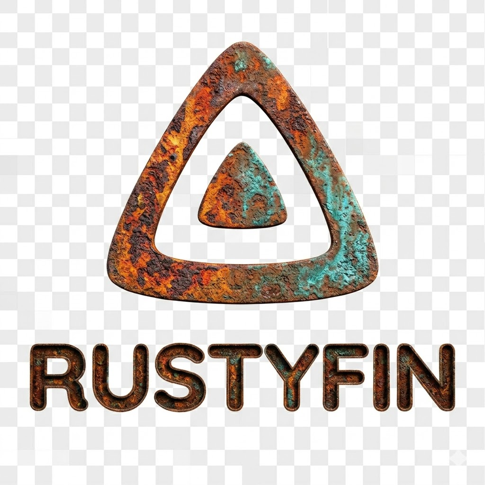

<p align="center">
  
</p>

<h1 align="center">Rustyfin</h1>

<p align="center">
  Ein leichtgewichtiger, Jellyfin-kompatibler Mediaserver – geschrieben in Rust.
</p>

---

## Übersicht

Rustyfin ist ein performanter, ressourcenschonender Mediaserver, der die Jellyfin-API implementiert. Dadurch können bestehende Jellyfin-Clients (Web, Android, iOS, TV) verwendet werden, um Medienbibliotheken zu durchsuchen und Inhalte zu streamen.

### Hauptmerkmale

- **Jellyfin-kompatible API** – Funktioniert mit bestehenden Jellyfin-Clients
- **Bibliotheksverwaltung** – Filme, Serien und Musik scannen und organisieren
- **Metadaten-Provider** – TMDb, OMDb und lokale NFO-Dateien
- **Bildverarbeitung** – Proxy mit Caching und Echtzeit-Skalierung
- **Direct Play / Direct Stream** – Video- und Audio-Streaming mit Seeking-Unterstützung
- **Authentifizierung** – JWT-basiert, API-Key-Support und Quick Connect
- **Benutzerverwaltung** – Mehrere Benutzer mit individuellen Richtlinien
- **SQLite-Datenbank** – Konfigurationsfreie, eingebettete Datenbank
- **Geringer Ressourcenverbrauch** – Gebaut mit async Rust (Tokio + Axum)

## Dokumentation

| Dokument | Beschreibung |
|---|---|
| [Setup-Anleitung](setup.md) | Installation und Ersteinrichtung |
| [Konfiguration](configuration.md) | Alle Konfigurationsoptionen |
| [API-Dokumentation](api.md) | Übersicht aller API-Endpoints |
| [Docker](docker.md) | Docker-Image und docker-compose |
| [Architektur](architecture.md) | Projektstruktur und Architektur |

## Schnellstart

```bash
# Repository klonen
git clone https://github.com/<your-username>/rustyfin.git
cd rustyfin

# Bauen und starten
cargo run --release
```

Rustyfin lauscht standardmäßig auf `0.0.0.0:8096`. Beim ersten Start wird ein Admin-Benutzer erstellt:

- **Benutzername:** `admin`
- **Passwort:** `admin`

> ⚠️ **Das Standard-Passwort sofort nach dem ersten Login ändern!**

## Lizenz

Dieses Projekt ist Open Source. Siehe [LICENSE](../LICENSE) für Details.
