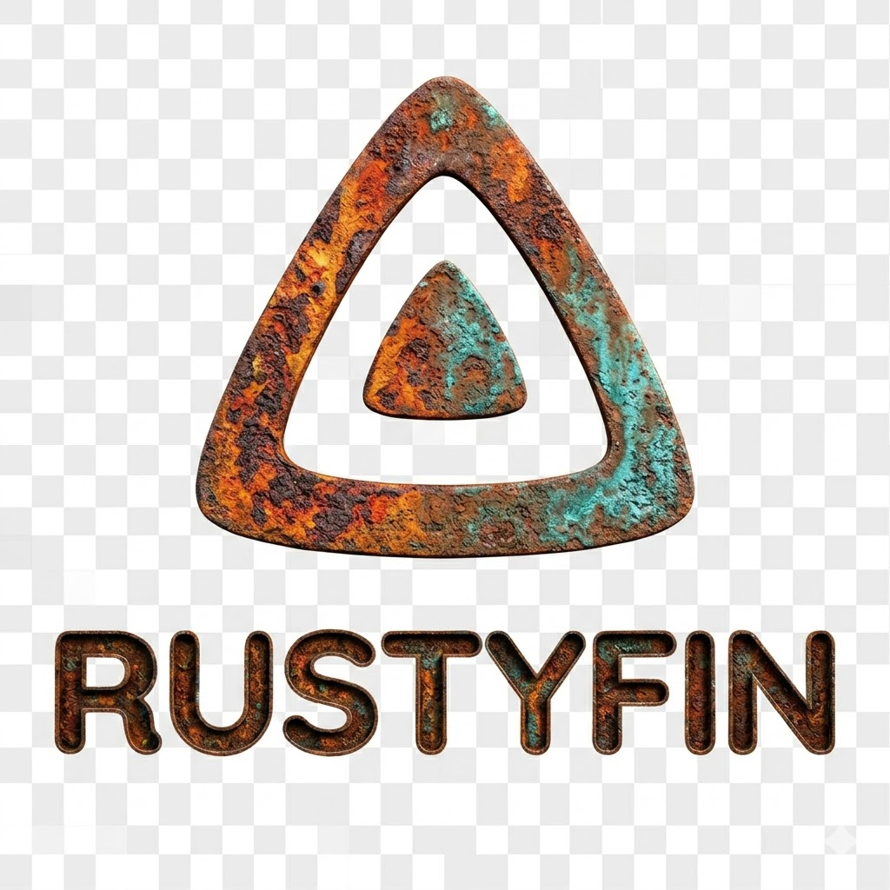

<p align="center">
  
</p>

# Setup-Anleitung

## Voraussetzungen

- **Rust** 1.85+ (Edition 2024)
- **SQLite** (wird über sqlx gebündelt mitgeliefert)
- *(Optional)* TMDb API-Key für Metadaten-Abruf
- *(Optional)* OMDb API-Key für Metadaten-Abruf

## Installation aus Quellcode

### 1. Repository klonen

```bash
git clone https://github.com/<your-username>/rustyfin.git
cd rustyfin
```

### 2. Release-Build erstellen

```bash
cargo build --release
```

Die fertige Binary befindet sich unter `target/release/rustyfin`.

### 3. Server starten

```bash
cargo run --release
```

Oder direkt die Binary ausführen:

```bash
./target/release/rustyfin
```

## Ersteinrichtung

Beim ersten Start erstellt Rustyfin automatisch:

1. Das Datenverzeichnis (Standard: `~/.rustyfin/`)
2. Die SQLite-Datenbank

### Administratorkonto

Es wird kein Standardbenutzer angelegt. Das erste Administratorkonto (der Server-Besitzer) erstellen Sie im Setup-Wizard.

### Setup-Wizard

Rustyfin bietet einen Setup-Wizard für die Ersteinrichtung über die API:

1. **Status prüfen:** `GET /System/Info/Public`. `StartupWizardCompleted` ist `false`, solange kein Server-Besitzer existiert.
2. **Konfiguration setzen:** `POST /Startup/Configuration`
3. **Server-Besitzer anlegen:** `POST /Startup/User`. Das ist nur einmal möglich.
4. **Anmelden:** `POST /Users/AuthenticateByName`
5. **Setup abschließen:** `POST /Startup/Complete`, mit dem Token aus Schritt 4.

Solange kein Server-Besitzer existiert, benötigen die `/Startup/*`-Endpunkte keine Anmeldung; danach können nur Administratoren sie nutzen.

Nach einem Update von einer älteren Version, deren Einrichtung bereits abgeschlossen war, wird der zuerst angelegte Administrator zum Server-Besitzer. Ein verbliebenes Konto `admin` mit dem Passwort `admin` wird deaktiviert, wenn der Server-Besitzer unter einem anderen Namen angelegt wird.

## Medienbibliothek einrichten

Nach der Ersteinrichtung können Medienbibliotheken über die API angelegt werden:

```bash
# Bibliothek erstellen (Authentifizierung erforderlich)
curl -X POST http://localhost:8096/Library/VirtualFolders \
  -H "Authorization: MediaBrowser Token=<your-token>" \
  -H "Content-Type: application/json" \
  -d '{
    "Name": "Filme",
    "CollectionType": "movies",
    "Paths": ["/pfad/zu/filmen"]
  }'
```

### Unterstützte Bibliothekstypen

| Typ | CollectionType |
|---|---|
| Filme | `movies` |
| Serien | `tvshows` |
| Musik | `music` |

## Nächste Schritte

- [Konfiguration](configuration.md) – Alle Umgebungsvariablen und Optionen
- [API-Dokumentation](api.md) – Vollständige API-Referenz
- [Docker](docker.md) – Container-basierte Installation
